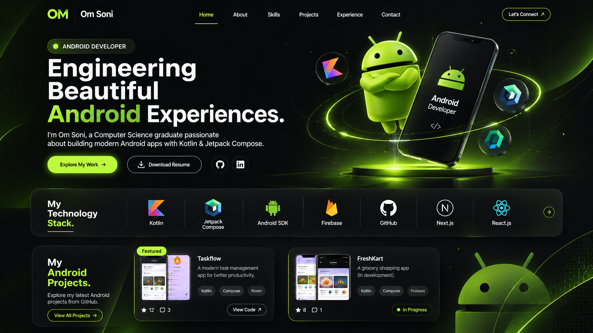

<div align="center">



# Om Soni

### Android Developer · Kotlin · Jetpack Compose

Building modern, intuitive, and scalable Android experiences.

<p>
  <a href="https://github.com/omsoni21"></a>
  <a href="mailto:somofficial9661@gmail.com"></a>
  <a href="https://linkedin.com/in/om-soni-57a424256"></a>
</p>

[Explore the code](#-getting-started) · [See the projects](#-featured-projects) · [Get in touch](#-contact)

</div>

---

## ✨ About

Welcome! I’m **Om Soni**, a Computer Science Engineering graduate based in Bhopal, India, focused on **native Android development**. I enjoy turning ideas into polished mobile experiences with modern Android tools and maintainable architecture.

| 📍 Location | 🎓 Education | 💼 Availability |
|:--|:--|:--|
| Bhopal, Madhya Pradesh, India | B.Tech, Computer Science Engineering | Open to Android Developer opportunities |

## 🧰 Tech Stack

<p>
  
  
  
  
  
  
</p>

Also familiar with **Firebase, Kotlin Coroutines, REST APIs, Git, React, Next.js, TypeScript,** and **Tailwind CSS**.

## 🚀 Featured Projects

<table>
  <tr>
    <td width="50%" valign="top">
      <h3>📋 Taskflow</h3>
      <p>A modern Android task manager with daily planning, Jetpack Compose UI, and offline-first Room persistence.</p>
      <p><strong>Built with:</strong> Kotlin · Jetpack Compose · Material Design 3 · Room</p>
      <a href="https://github.com/omsoni21/Taskflow">Source code</a> · <a href="https://github.com/omsoni21/Taskflow/raw/main/Taskflow-v1.0.apk">Download APK</a>
    </td>
    <td width="50%" valign="top">
      <h3>💸 Expense Tracker</h3>
      <p>Track daily income and expenses in a clean Android app with local storage and MVVM architecture.</p>
      <p><strong>Built with:</strong> Kotlin · Jetpack Compose · Room · MVVM</p>
    </td>
  </tr>
  <tr>
    <td width="50%" valign="top">
      <h3>🛒 FreshKart</h3>
      <p>A grocery shopping app concept with customer and seller experiences, currently in development.</p>
      <p><strong>Built with:</strong> Kotlin · Jetpack Compose · Firebase</p>
    </td>
    <td width="50%" valign="top">
      <h3>🎓 Alumni Platform</h3>
      <p>A responsive alumni networking platform with authentication and a MongoDB-backed directory.</p>
      <p><strong>Built with:</strong> JavaScript · MongoDB · Responsive UI</p>
      <a href="https://alumni-ses.netlify.app">View live</a>
    </td>
  </tr>
</table>

## 🖥️ Getting Started

Run the portfolio locally with Node.js and npm:

```bash
# Clone the repository
git clone https://github.com/omsoni21/portfo.git
cd portfo

# Install dependencies
npm install

# Start the development server at http://localhost:3000
npm run dev
```

### Useful commands

| Command | Description |
|:--|:--|
| `npm run dev` | Start the local development server |
| `npm run lint` | Run the TypeScript check |
| `npm run build` | Create a production build |
| `npm start` | Start the server |

## ⚙️ Configuration

No environment variables are required. Optional settings can be added to a local `.env` file:

| Variable | Purpose |
|:--|:--|
| `VITE_FORMSPREE_ENDPOINT` | Formspree endpoint for receiving contact form submissions. Without it, the form opens a pre-filled email draft. |
| `GITHUB_TOKEN` | Optional GitHub token to increase the API rate limit for public activity. |

See [`.env.example`](./.env.example) for the template. Never commit secrets or personal access tokens.

## 🗂️ Project Structure

```text
├── public/                 # Resume and project artwork
├── src/
│   ├── assets/images/      # Portfolio project thumbnails
│   ├── components/         # Page sections and interactive demos
│   ├── data/portfolio.ts   # Portfolio content and project details
│   ├── types/              # Shared TypeScript types
│   └── utils/              # SEO and supporting utilities
├── server.ts               # Express server and Vite development middleware
└── README.md
```

### Update portfolio content

- **Projects, skills, experience, and profile:** edit [`src/data/portfolio.ts`](./src/data/portfolio.ts).
- **Project images:** add artwork under `public/assets/projects/` and update the matching project’s `screenshotPath`.
- **Resume:** replace `public/resume.pdf`.

## ☁️ Deployment

Build the production assets with `npm run build`. The Express server can be deployed to a Node.js host such as **Render, Railway, Fly.io,** or **Cloud Run**. It listens on port `3000`.

For Vercel’s serverless deployment, configure the server endpoints (including `/api/github`) as serverless functions.

## 📬 Contact

Interested in working together or have a project in mind? I’d love to hear from you.

- **Email:** [somofficial9661@gmail.com](mailto:somofficial9661@gmail.com)
- **GitHub:** [github.com/omsoni21](https://github.com/omsoni21)
- **LinkedIn:** [linkedin.com/in/om-soni-57a424256](https://linkedin.com/in/om-soni-57a424256)

---

<div align="center">
  <sub>Designed and built with care by <a href="https://github.com/omsoni21">Om Soni</a> · Made with React, TypeScript, and Vite</sub>
</div>
